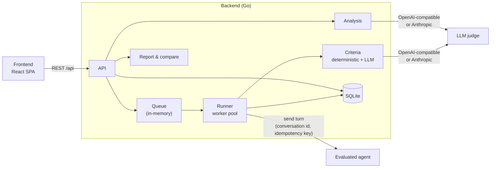
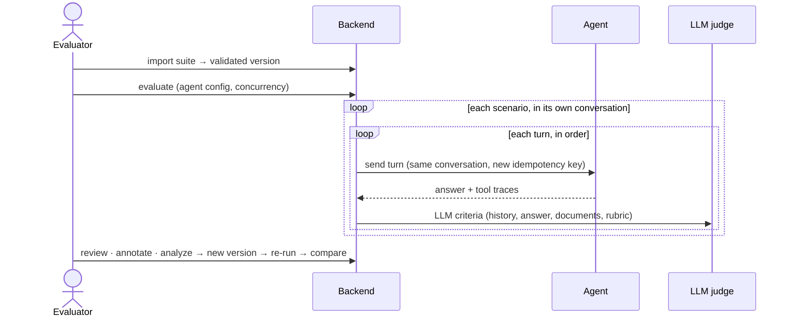
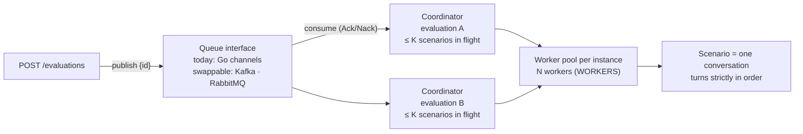

<p align="center">
  
</p>

# Agent Evaluator

A service and web interface for evaluating **conversational agents through multi-turn scenarios**. Every scenario runs in its own isolated conversation and **every turn is judged** with an explanation and evidence, so you can see exactly where a conversation breaks, annotate it, ask for a second opinion and compare runs over time.

It is **agent-agnostic**: the evaluated agent, its traces, the LLM judge and the queue are interfaces. Any agent plugs in with two small adapters and one registry entry.

| Component | Contents |
|---|---|
| [`backend/`](backend/) | Go API: suites, async execution, per-turn criteria, LLM judge, analysis, comparison |
| [`frontend/`](frontend/) | React SPA for reviewing and comparing evaluations |
| [`scenarios/`](scenarios/example.suite.yaml) | Agent-agnostic example suite (runs offline with the fake agent) |

## Why

Whole-conversation verdicts and raw JSON are not enough for a multi-turn agent. The questions that matter are: in which turn did it break, was the context kept, is the failure real or is the rubric too strict, and did a change help.

| Area | What it provides |
|---|---|
| Suite validation | Versioned YAML with explicit criteria per turn. Every error is reported with its path |
| Per-turn evaluation | Deterministic criteria (tools, retrieved sources, regex) and LLM criteria (expected behaviour, context retention), each with explanation and evidence; first failed turn |
| Visual review | Chat transcript with a verdict per turn, "where conversations break", evidence highlighted in the answer |
| Traces | Conversation → turn → tool call, with latency per call and tokens per turn and conversation |
| Human in the loop | Annotations per turn. **Analyze**: an LLM second opinion (real failure, false positive, judge too lax) that reads the annotations |
| Comparison | At suite, conversation and turn level: regressions, improvements, rubric changes, config diff, word diff, trend across versions |
| Cost | Agent cost and judge cost reported separately |

## Quick start

Requirements: Go 1.25+, Node 22+ and `make`.

```bash
make install     # frontend dependencies, once
make run-fake    # fake agent and judge, no credentials: http://localhost:5173
```

To evaluate a real agent, copy `backend/.env.example` to `backend/.env`, fill in the [variables](#configuration) and run `make run`.

| Goal | Backend | Frontend | Both |
|---|---|---|---|
| Test | `make test-backend` (Go tests, race detector) | `make test-frontend` (lint + unit) · `make test-e2e` (Playwright) | `make test` |
| Build | `make build-backend` → `backend/server` | `make build-frontend` → `frontend/dist` | `make build` |
| Run | `make run-backend` (:8080) | `make run-frontend` (:5173, proxies `/api`) | `make run` · `make run-fake` |
| Clean | `make clean-backend` | `make clean-frontend` | `make clean` |

- `make run` uses the agent and judge from `backend/.env`; `make run-fake` uses fakes and a separate database (`backend/evaluator-fake.db`). `Ctrl+C` stops both processes.
- `make clean` removes generated files only; it keeps `backend/evaluator.db` (your evaluations) and `frontend/node_modules`.
- `make help` lists every target.

Backend only:

```bash
cd backend
cp .env.example .env     # never commit .env
go run ./cmd/server      # http://localhost:8080/api/health
AGENT=fake JUDGE_PROVIDER=fake go run ./cmd/server   # no credentials, no external calls
curl --data-binary @../scenarios/example.suite.yaml localhost:8080/api/suites
```

Frontend only (needs the backend running):

```bash
cd frontend
npm ci
npm run dev                         # http://localhost:5173
npx playwright install chromium     # once, for the e2e test
```

## Architecture





### Design principles

- **Turn-level evaluation with its own runner**, instead of judging whole conversations.
- **Ports and adapters.** The evaluated agent, its trace source, the LLM judge and the queue are interfaces; fakes power the tests and offline demos. Stateful or stateless, idempotent or not, any agent fits ([connect another agent](#connect-another-agent)). Traces are queried separately from the answer (OpenTelemetry-style), not assumed inline.
- **The backend computes; the frontend presents.** Verdicts, comparison and aggregates live in one tested place.
- **Immutable, versioned suites.** Comparison matches scenarios by `key` and turns by index, and flags changed rubrics so they are not mistaken for agent changes.
- **Reliable execution.** Every turn and its idempotency key are persisted before sending, and retries reuse the key. A turn that may still be running on the agent (409 after a lost response) is awaited, not resent. Unfinished work resumes after a restart.
- **Extensible criteria.** Adding a new kind of check does not change the rest of the system.
- **Vendor-neutral judge.** Default protocol is OpenAI-compatible Chat Completions; Anthropic is optional. Plain `net/http`, no SDK. Untrusted agent output is delimited and neutralized against prompt injection.
- **No secrets in the browser.** Credentials live only on the server.

### Concurrency and queueing

Starting an evaluation only **publishes its id** to a `Queue`. Consumers run it, so requesting work is decoupled from executing it and several evaluations run at the same time.



- **Two limits.** The **global** limit (`WORKERS`, *N* per instance) bounds the load sent to the agent and the judge. The **per-evaluation** limit (`concurrency`, *K*) shares the pool fairly, so a large run cannot starve a small one. The unit of concurrency is the **scenario**; turns of a conversation are never parallel.
- **Ready for a broker.** `Queue` already has `Publish`, `Consume` and `Ack`/`Nack`, so Kafka or RabbitMQ is a new implementation, not a redesign. Messages carry ids only and the **database is the source of truth**; unfinished work is re-enqueued at start-up and idempotency keys make redelivery safe.
- **Scaling out.** With a broker and several instances, the global limit becomes *N × instances*. To keep a per-evaluation limit across instances, publish **one message per scenario** (partitioned by evaluation in Kafka, or a queue with prefetch in RabbitMQ) instead of one per evaluation. Not built yet.

## Suite format

```yaml
name: Mortgages                 # same name = new version
scenarios:
  - key: mortgage               # stable across versions; used to compare
    name: "mortgage | follow-up"
    tags: [mortgage]
    turns:
      - question: "What is the first-home loan?"
        criteria:
          - {type: llm_judge, expected: "Describes requirements without recommending"}
          - {type: tools_required, tools: [search]}
          - {type: sources_retrieved, urls: ["https://example.com/..."], match: any}
      - question: "And the monthly payment?"
        criteria:
          - {type: context_retention, expected: "Keeps talking about the first-home loan"}
          - {type: regex, pattern: "utm_", negate: true}
```

| Criterion | Type | Checks |
|---|---|---|
| `tools_required` / `tools_forbidden` | deterministic | tools called / not called in this turn |
| `sources_retrieved` | deterministic | expected URLs among the retrieved documents (`match: all` or `any`) |
| `regex` | deterministic | pattern present, or absent with `negate: true` |
| `llm_judge` | LLM | answer satisfies `expected`, given history and documents |
| `context_retention` | LLM | answer uses the context from previous turns |

Uploading a suite with the same name creates a new version; a run's definition is never modified. The minimum number of turns per scenario is set by the server (`SUITE_MIN_TURNS`). A generic example, runnable with the fake agent, is in [`scenarios/example.suite.yaml`](scenarios/example.suite.yaml); adapters may ship their own under `backend/internal/agent/<name>/examples/`.

## Configuration

The server loads `.env` from its working directory; real environment variables take precedence.

| Variable | Required | Default | Purpose |
|---|---|---|---|
| `AGENT` | **yes** | — | Adapter registered in [`backend/cmd/server/agents.go`](backend/cmd/server/agents.go). Bundled: `fake` (offline) and `hiringlab` ([its settings](backend/internal/agent/hiringlab/README.md)). No default: the evaluator assumes no agent |
| Adapter variables | with that `AGENT` | — | Each adapter reads its own (URL, credentials…); documented next to the adapter |
| `JUDGE_PROVIDER` | no | `openai-compatible` | `openai-compatible`, `anthropic` or `fake` |
| `JUDGE_BASE_URL` | with `openai-compatible` | — | Provider URL including `/v1`; no provider is assumed |
| `JUDGE_API_KEY` | for LLM criteria and Analyze | — | Provider key |
| `JUDGE_MODEL` | with `anthropic` | `gpt-5.4-mini` (openai-compatible) | Model id |
| `JUDGE_RESPONSE_FORMAT` | no | `json_schema` | openai-compatible only: `json_schema`, `json_object` or `text` |
| `JUDGE_EFFORT` | no | `high` | anthropic only |
| `JUDGE_AGENT_DESCRIPTION` | no | `an AI assistant` | Who is evaluated, named in the judge and Analyze prompts (e.g. `a customer support assistant`) |
| `PORT` · `DB_PATH` | no | `8080` · `evaluator.db` | HTTP port · SQLite file |
| `WORKERS` · `DEFAULT_CONCURRENCY` | no | `4` · `2` | Global worker pool · scenarios in flight per evaluation |
| `SUITE_MIN_TURNS` | no | `3` | Minimum turns per scenario, enforced on import |
| `CORS_ALLOWED_ORIGIN` | no | — | Allowed browser origin; empty means same origin only |

`GET /api/health` returns 503 if the database or agent configuration is missing. A missing judge configuration is only a warning, because deterministic-only suites still run. The frontend has two optional variables: `VITE_API_TARGET` (default `http://localhost:8080`, used by the dev/preview proxy) and `VITE_API_BASE` (default `/api`).

## Connect another agent

The core only knows the contracts in [`internal/agent`](backend/internal/agent/agent.go) and [`internal/tracing`](backend/internal/tracing/tracing.go). To evaluate another agent:

1. **Agent adapter** in `backend/internal/agent/<name>/`: implement `Agent` (`NewConversation`) and `Conversation` (`Ref`, `Send`).
   - Return the answer in `TurnOutput.Text`, plus `Tokens`, `DurationMs`, the raw response in `Raw` and, if available, `EffectiveConfig`.
   - Classify errors: `ErrRetryable` (safe to resend), `ErrConflict` (a turn is already running) or `ErrFatal`.
   - **Stateful** agent (keeps the conversation by id): return that id from `Ref()` and ignore `TurnInput.History`. **Stateless** agent (e.g. a chat completions API): send `TurnInput.History` with the message; the runner fills it, also after a restart.
   - Implement `Idempotent() bool` only if the agent deduplicates by `TurnInput.IdempotencyKey`. Without it, an interrupted turn is reported as an execution error instead of being resent.
   - `ConversationSpec.Config` carries the evaluation's `agentConfig` JSON as is.
2. **Trace source** in `backend/internal/tracing/<name>/`: implement `Source.Spans`. Return `nil` if the agent exposes no trace; otherwise map each step to a `domain.Span` (`Kind: "tool"`, tool name, latency), with the input under `domain.SpanAttrArguments` and any retrieved documents in `Documents`.
3. **Register it** in `backend/cmd/server/agents.go`: one factory that reads its environment variables and returns the agent, the trace source and a health check, plus one entry in `agents`. Run with `AGENT=<name>`.
4. **Describe it to the judge** with `JUDGE_AGENT_DESCRIPTION`.
5. **Write a suite.** `regex`, `llm_judge` and `context_retention` work for any agent; `tools_required`, `tools_forbidden` and `sources_retrieved` need a trace source.

Test the adapter with `httptest`, as [`hiringlab_test.go`](backend/internal/agent/hiringlab/hiringlab_test.go) does, and the whole flow with `AGENT=<name> go run ./cmd/server` and a suite.

## Using the interface

| Route | View | API |
|---|---|---|
| `/suites` | Suites grouped by name; import YAML with errors located | `GET`·`POST /suites` |
| `/suites/:id` | Versions, scenarios and criteria; evaluate; new version from the stored YAML; history with trend; pick two runs to compare | `GET /suites/{id}`, `GET …/source`, `POST /evaluations`, `GET /evaluations?suite=` |
| `/evaluations/:id` | Live progress, KPIs, where conversations break, criteria, tools, effective config; scenario table with verdict per turn and filters (including pending review); analyze failures | `GET /evaluations/{id}`, `GET …/scenarios`, `POST …/analysis?only=failed` |
| `/evaluations/:id/scenarios/:key` | Chat transcript; **Traces** tab (conversation → turn → call: latency, tokens) | `GET …/scenarios/{key}` |
| `…?turn=n` (drawer) | Evidence highlighted, criteria, **Analyze**, annotations, calls with documents | `GET …/turns/{n}`, `…/analysis`, `…/annotations` |
| `/evaluations/:id/compare/:baseId` | Deltas, outcome filters, rubric changes, verdict strips, config diff | `GET …/comparison?with=` |
| `…/compare/:baseId/scenarios/:key?turn=n` | Turns side by side; turn drawer with word diff | `GET …/scenarios/{key}/comparison`, `…/turns/{n}/comparison` |

View state (filters, open turn, base run, tab) lives in the URL, so any view can be shared.

## REST API (`/api`)

| Endpoint | Description |
|---|---|
| `POST /suites` | Import YAML. Returns 201 for a new version, 200 if identical to the latest, or 400 with each error and its path |
| `GET /suites` · `/suites/{id}` · `/suites/{id}/scenarios/{key}` · `/suites/{id}/source` | Definition and the original YAML |
| `POST /evaluations` | `{suiteId, label, agentConfig, concurrency}`. Returns 202 with `Location` |
| `GET /evaluations?suite={name}` | Evaluations of every version of a suite, with their summary |
| `GET /evaluations/{id}` | Status and summary (pass rates, first failed turn, tokens, tools) |
| `GET /evaluations/{id}/scenarios[/{key}[/turns/{n}]]` | Results with light spans and `latestAnalysis`; the turn detail adds arguments and documents |
| `GET`·`POST …/turns/{n}/annotations` | Reviewer notes |
| `GET`·`POST …/turns/{n}/analysis` | LLM second opinion: `real_failure`, `false_positive`, `judge_too_lax` or `correct`, with root cause and recommendation |
| `POST /evaluations/{id}/analysis?only=failed` | Background analysis of failed turns (202) |
| `GET /evaluations/{id}[/scenarios/{key}[/turns/{n}]]/comparison?with={base}` | Comparison views |
| `GET /health` | Database, agent and judge configuration |

## Code map

```
backend/
  cmd/server     wiring: the only place with concrete implementations (agents.go: agent registry)
  agent/hiringlab/cmd/convert  Hiring Lab only: legacy scenarios format → suite format
  internal/
    domain       entities and verdict rules
    suite        YAML parsing and validation
    criteria     Criterion interface, built-ins, registry
    judge        LLM judge and analyzer (OpenAI-compatible, Anthropic, fake)
    agent        Agent interface (+ optional Idempotent), adapters (fake, hiringlab)
    tracing      TraceSource interface + adapters
    queue        Queue interface + in-memory implementation
    runner       per-evaluation coordinator + global worker pool
    analysis     second-opinion service
    store        SQLite (embedded schema, hand-written SQL)
    report       read models · compare: diffs at three levels
    api          HTTP handlers (Go 1.22 routing) and acceptance tests
frontend/
  src/api        types (contract) · HTTP client · injection · react-query hooks
  src/domain     declarative presentation tables · formatting · word diff (pure, unit-tested)
  src/ui         presentational components with primitive props
  src/features   suites · evaluation · conversation · traces · analysis · compare
scenarios/       agent-agnostic example suites
```

- **Backend**: Go with the standard library and minimal dependencies. Runtime: `modernc.org/sqlite` (pure Go, embedded) and `gopkg.in/yaml.v3`; tests only: `github.com/cucumber/godog`.
- **Frontend**: React, TypeScript (strict), react-router, react-query, react-markdown and recharts. Declarative tables mean a new criterion type is one entry in `domain/views.ts`; component tests use an injected fake client instead of mocking `fetch`. Accessible by construction: semantic roles, focus management in drawers, verdicts with icon + text. Dependency versions are pinned exactly.

## Testing

| What | How |
|---|---|
| Everything | `make test` |
| Backend | `cd backend && go test -race ./...` · `go test -v -run TestFeatures ./internal/api/` for readable acceptance output |
| Frontend | `npm test` (Vitest + Testing Library) · `npm run lint` · `npm run build` · `npm run audit` |
| End to end | `npm run test:e2e` (Playwright) starts the backend with fakes and a fresh database, then walks the full journey. `SHOTS=<dir> npx playwright test screenshots` captures every view |

- **Acceptance (godog)**: [`evaluation_lifecycle.feature`](backend/internal/api/features/evaluation_lifecycle.feature) runs against the real HTTP API with a fake agent and an in-memory store: invalid suite rejected with every error located, full cycle (import, evaluate, review, annotate, analyze, fix the rubric in a new version, re-run, compare at three levels) and batch analysis.
- **Runner**: context and isolation, retries with the same key, 409 mid-conversation and after a lost response, resume after a crash, concurrency limits, no starvation, prompt-injection leak, and stateless non-idempotent agents.
- **Judge**: both protocols, structured output, retries and isolation from prompt injection.
- **E2E journey**: invalid suite rejected → evaluate → find where a conversation breaks → annotate → Analyze → Traces → fix the rubric in version 2 and re-run → compare.

## Trade-offs and limitations

- Go stdlib and SQLite with one connection: little code and easy to run, but serialized writes.
- The in-memory queue sits behind an interface; durability comes from the database and recovery at start-up.
- Re-running after a rubric change mixes agent variability with rubric effects; the `changed` flag makes it visible but does not remove it.
- Tokens are only available per turn; tool calls report latency. LLM calls inside the agent are not visible.
- LLM judges can be too lax or too strict. Mitigation: deterministic criteria where possible, evidence on every verdict, annotations and **Analyze**.
- The judge costs about as many tokens as the agent, because it receives all retrieved documents.

## Roadmap

- Users and authorization (today a single-user local tool; annotation authors are free text).
- A real broker, multiple instances and a database other than SQLite.
- Cancelling or retrying a single scenario, repetitions with variance, re-judging stored transcripts without re-running the agent.
- Overriding a verdict from an annotation, or generating a new suite version from annotations.
